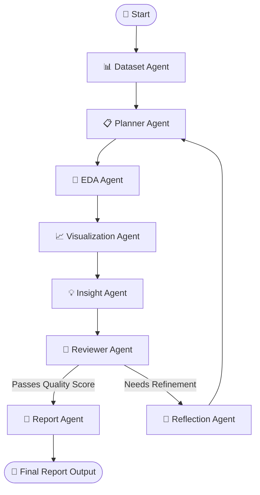

# 🤖 Autonomous Data Analyst Agent

[](https://www.python.org/)
[](https://github.com/langchain-ai/langgraph)
[](https://flask.palletsprojects.com/)
[](https://react.dev/)
[](LICENSE)

An intelligent, end-to-end multi-agent framework powered by **LangGraph**, **LangChain**, **Groq LLM / Google Gemini**, and **React**. The Autonomous Data Analyst Agent takes raw datasets (CSV, Excel), performs automated data cleaning, exploratory data analysis (EDA), generates interactive visualizations, extracts deep domain insights, and compiles executive-ready PDF & Markdown reports with continuous self-reflection and quality control.

---

## 🌟 Key Features

- 🧠 **8-Agent LangGraph Workflow**: Specialized LLM-powered agents collaborate seamlessly to analyze data from initial inspection to final report generation.
- 🔍 **Automated Exploratory Data Analysis (EDA)**: Automatic schema detection, data distribution analysis, statistical summaries, missing value handling, and correlation discovery.
- 📊 **Dynamic Visualization Generation**: Automatically generates clean, publication-ready charts using `matplotlib`, `seaborn`, and `plotly`.
- 💡 **Context-Aware Insight Extraction**: Identifies key business trends, anomalies, statistical correlations, and actionable domain takeaways.
- 🔁 **Self-Correction & Quality Control**: A dedicated **Reviewer Agent** evaluates analysis quality against stringent criteria. If quality standards aren't met, a **Reflection Agent** re-plans and refines the execution path.
- 📄 **Executive PDF & Markdown Reports**: Automatically compiles structured multi-page PDF documents (via `reportlab`) and interactive Markdown summaries.
- 🌐 **Modern React Frontend**: Clean, interactive Web UI for dataset uploading, query input, real-time pipeline progress tracking, and report visualization.
- ⚡ **RESTful Flask API**: Thread-safe background job execution, SQLite history logging (`history.db`), and status streaming.

---

## 🏗️ Multi-Agent Architecture & Workflow

The system relies on a directed graph built with **LangGraph**, featuring conditional self-correction loops:



### Specialized Agents

| Agent | Description |
|---|---|
| **Dataset Agent** | Loads dataset, inspects columns, data types, missing counts, and summary statistics. |
| **Planner Agent** | Formulates a structured multi-step analysis strategy tailored to dataset features and user queries. |
| **EDA Agent** | Executes python code for mathematical computations, aggregations, and distributions. |
| **Visualization Agent** | Selects optimal chart types and generates visual assets (Bar, Scatter, Line, Heatmap, Boxplot). |
| **Insight Agent** | Interprets findings to derive high-level strategic business insights. |
| **Reviewer Agent** | Scores analysis depth, accuracy, chart relevance, and query alignment. |
| **Reflection Agent** | Analyzes reviewer feedback and formulates corrective instructions when score is low. |
| **Report Agent** | Assembles final structured executive report with embedded figures and formatted text. |

---

## 📁 Repository Structure

```
Data Analyst Agent/
├── api/
│   ├── app.py                # Flask REST API server & background job runner
│   └── __init__.py
├── backend/
│   ├── agents/               # Individual Agent definitions
│   │   ├── dataset_agent.py
│   │   ├── eda_agent.py
│   │   ├── insight_agent.py
│   │   ├── planner_agent.py
│   │   ├── reflection_agent.py
│   │   ├── report_agent.py
│   │   ├── reviewer_agent.py
│   │   └── visualization_agent.py
│   ├── graphs/               # LangGraph state machine & conditional router
│   │   ├── analyst_graph.py
│   │   └── state.py
│   ├── prompts/              # System prompts for each agent stage
│   └── tools/                # Execution tools (EDA, visualizations, loaders, S3 uploader)
│       ├── data_loader.py
│       ├── eda_tools.py
│       ├── s3_uploader.py
│       └── visualization_tools.py
├── frontend/                 # Vite + React frontend dashboard
│   ├── src/
│   ├── package.json
│   └── vite.config.js
├── datasets/                 # Sample datasets directory
├── reports/                  # Generated PDF & Markdown output reports
├── .env.example              # Environment variables template
├── history.db                # SQLite database for execution history
├── requirements.txt          # Python dependencies
└── README.md
```

---

## 🚀 Getting Started

### Prerequisites

- **Python**: `3.10` or higher
- **Node.js**: `18.0` or higher & `npm`

---

### 1. Environment Setup

Clone the repository and configure environment variables:

```bash
git clone https://github.com/anshKjha10/Data-Analyst-Agent.git
cd Data-Analyst-Agent
```

Create a `.env` file in the root directory (refer to `.env.example`):

```env
GROQ_API_KEY=your_groq_api_key_here
GROQ_MODEL_NAME=llama-3.3-70b-versatile

# Optional AWS S3 Configuration
AWS_ACCESS_KEY_ID=your_access_key
AWS_SECRET_ACCESS_KEY=your_secret_key
AWS_REGION=us-east-1
AWS_S3_BUCKET=your_bucket_name
```

---

### 2. Backend Setup & Execution

1. **Create and activate a virtual environment**:
   ```bash
   python -m venv venv
   # On Windows:
   .\venv\Scripts\activate
   # On macOS/Linux:
   source venv/bin/activate
   ```

2. **Install backend dependencies**:
   ```bash
   pip install -r requirements.txt
   ```

3. **Start the Flask API server**:
   ```bash
   python api/app.py
   ```
   *The backend will run on `http://localhost:5000`.*

---

### 3. Frontend Setup & Execution

1. **Navigate to the frontend directory**:
   ```bash
   cd frontend
   ```

2. **Install Node dependencies**:
   ```bash
   npm install
   ```

3. **Launch the development server**:
   ```bash
   npm run dev
   ```
   *The frontend dashboard will open on `http://localhost:5173`.*

---

## 🔌 API Reference

| Endpoint | Method | Description |
|---|---|---|
| `/api/analyze` | `POST` | Upload dataset file and query to trigger multi-agent analysis |
| `/api/status/<job_id>` | `GET` | Retrieve real-time execution status, current agent step, and metrics |
| `/api/result/<job_id>` | `GET` | Get completed analysis results, insights, and report download links |
| `/api/history` | `GET` | Fetch list of past analysis executions logged in SQLite database |
| `/api/reports/<filename>`| `GET` | Serve generated PDF or chart artifacts |

---

## 🛠️ Tech Stack & Libraries

- **LLM & Agent Framework**: [LangGraph](https://github.com/langchain-ai/langgraph), [LangChain](https://github.com/langchain-ai/langchain), [Groq LLM](https://groq.com/)
- **Data Processing**: [Pandas](https://pandas.pydata.org/), [NumPy](https://numpy.org/), [SciPy](https://scipy.org/)
- **Visualization**: [Matplotlib](https://matplotlib.org/), [Seaborn](https://seaborn.pydata.org/), [Plotly](https://plotly.com/python/)
- **Report Generation**: [ReportLab](https://www.reportlab.com/)
- **Backend API**: Python, Flask, Flask-CORS, SQLite, Gunicorn
- **Frontend App**: React 19, Vite, Tailwind CSS

---

## 🤝 Contributing

Contributions are welcome! If you'd like to improve agent prompts, add new visualization tools, or enhance UI features:

1. Fork the Project
2. Create your Feature Branch (`git checkout -b feature/AmazingFeature`)
3. Commit your Changes (`git commit -m 'Add some AmazingFeature'`)
4. Push to the Branch (`git push origin feature/AmazingFeature`)
5. Open a Pull Request

---

## 📜 License

Distributed under the MIT License. See `LICENSE` for more information.
